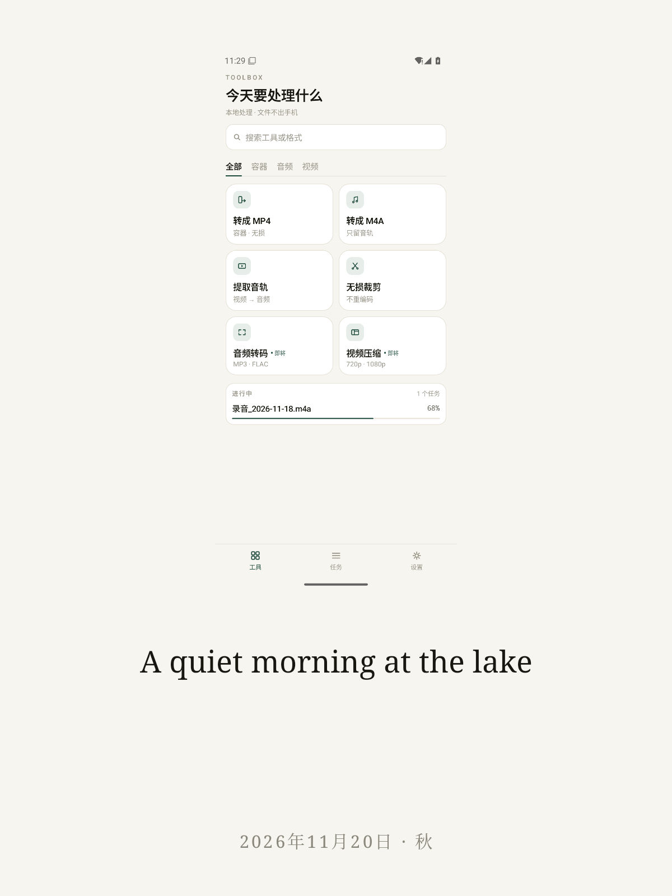
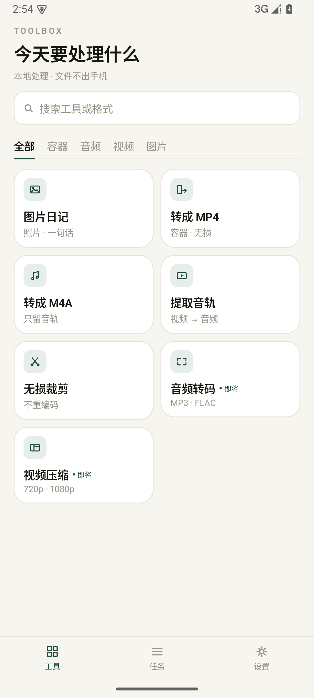
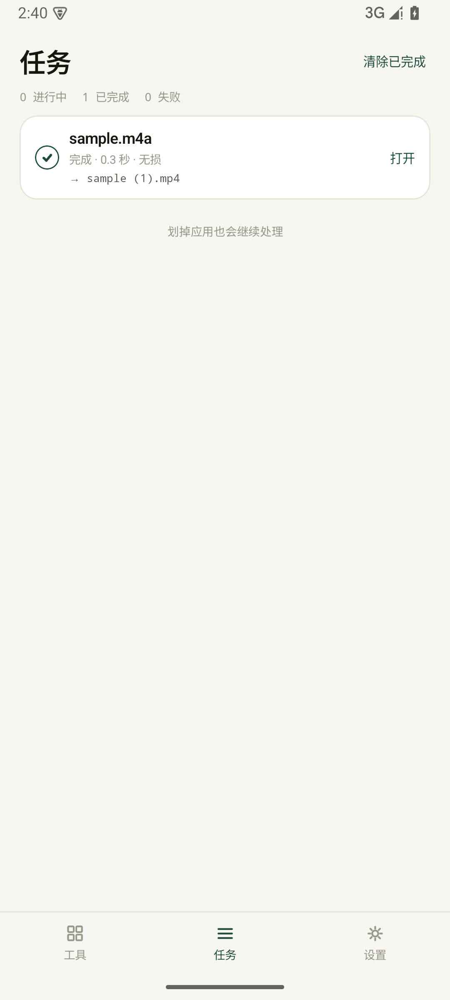
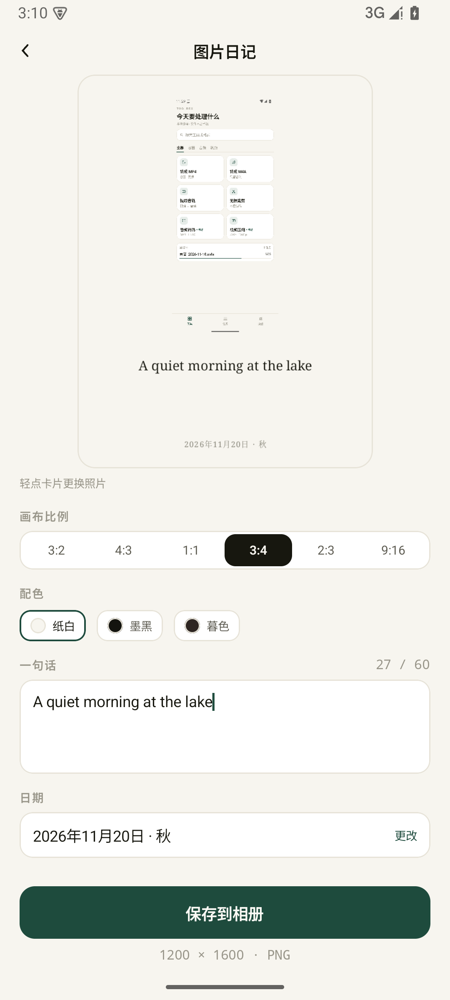

<div align="center">

# MyToolbox

**把手机里的音视频，用最少的操作、最好的质量，变成你要的格式。**

纯本地 · 零上传 · 能无损就不转码




</div>

---

## 这是什么

一个 Android 本地媒体工具箱。四个真实可用的工具，全部在本机完成，不联网、不上传、不申请存储全盘权限。

| 工具 | 做什么 | 关键技术 |
|---|---|---|
| **转成 MP4** | m4a → mp4 | 只改 `ftyp` 品牌字节，媒体数据零改动 |
| **转成 M4A** | 视频 → 纯音轨 | MediaExtractor → MediaMuxer 样本透传 |
| **无损裁剪** | 按时间区间截取 | 删样本 + 时间戳前移，不解码 |
| **图片日记** | 照片 + 一句话 → 卡片 | Canvas 直绘，6 种字体 / 6 种比例 / 自定义留白与配色 |

---

## 无损是真的无损

市面上的"转格式"大多在重新编码。MyToolbox 对标准 m4a 的做法是：**只改 4 个字节**。

因为 m4a 和 mp4 本来就同属 ISO/IEC 14496-12，差别只是 `ftyp` 里的品牌标识（`M4A ` vs `mp42`）。改完品牌，文件从"iTunes 音频"变成"通用 MP4"，而采样表、偏移、封面、章节一个字节没动。

```console
$ cmp -l sample.m4a sample.mp4
     9 115 155
    10  64 160
    11 101  64
    12  40  62
```

51,403 字节的文件，**只有 4 个字节不同**，其余逐字节相同。没有解码，没有重编码，音质不可能有损失。

> 这也是本项目不引入 FFmpeg 的原因：对一个改 4 字节的需求，40MB 的 native 库是负资产。

---

## 截图

<table>
<tr>
<td width="33%"></td>
<td width="33%"></td>
<td width="33%"></td>
</tr>
<tr>
<td align="center"><sub>工具目录 · 按处理层级分组</sub></td>
<td align="center"><sub>队列 · 显示实际输出名</sub></td>
<td align="center"><sub>图片日记 · 六种比例</sub></td>
</tr>
</table>

界面遵循一套固定的设计系统：暖纸底 `#F7F5EF`、单一强调色松绿 `#1E4B3D`、1px 细线分层、不用阴影与渐变、数字全部等宽对齐。

---

## 架构

```
app                    组装、导航、AppGraph（唯一知道引擎实现的地方）
├── core:model         领域模型 · ProbeResult · 工具目录 · 时间码
├── core:media         BoxWalker · MediaProber · FtypPatcher · UriProber
├── core:storage       OutputHandle · MediaStoreOutputStore
├── core:task          JobRepository（串行执行 + Room + 中断恢复）
├── core:ui            设计系统 · 组件 · 自绘图标
├── engine:api         MediaEngine / EnginePlan / ExecutionContext
├── engine:platform    FtypRemuxEngine · PlatformRemuxEngine · OutputVerifier
├── feature:home       首页（目录驱动）
├── feature:tool       工具页（参数表单自动渲染）
├── feature:queue      任务队列
└── feature:diary      图片日记
```

三条设计原则：

**按处理层级分引擎，不按音视频分模块。** 决定成本的是"要不要解码"，不是"是音频还是视频"。

**两个稳定接口撑起扩展。** `ToolSpec` 声明输入、参数、输出；`MediaEngine` 的 `plan()` 与 `execute()` 分离。新增一个转换工具不需要改 UI —— 工具页没有一行 `if (toolId == ...)`，参数区由声明自动渲染。这一点已经用"视频 → M4A"验证过：UI 零改动。

**先预判，再动手。** `plan()` 在开始前就告诉用户"可无损 / 需重封装 / 不支持"，而不是跑到一半才报错。

---

## 快速开始

```bash
# 环境：JDK 17、Android SDK 35
./gradlew :app:assembleDebug
./gradlew :app:installDebug
```

产物：`app/build/outputs/apk/debug/app-debug.apk`

最低支持 Android 8.0（API 26），目标 API 35。

---

## 实测数据

所有数字来自 API 35 模拟器上的真实运行，不是估算。

| 场景 | 输入 | 输出 | 说明 |
|---|---|---|---|
| m4a → mp4 | 51,403 B | 51,403 B | 4 字节差异，其余完全一致 |
| 兜底重封装 | 51,403 B | 50,539 B | 品牌不可改写时重建容器，音质不变 |
| 视频 → m4a | 173,780 B / 2 轨 | 44,140 B / 1 轨 | 只保留音频轨，`ftyp=M4A` |
| 无损裁剪 | 5.00 s | 2.018 s | 误差 18 ms，不足一个 AAC 帧 |
| 图片日记 | — | 1200 × 1600 PNG | 照片 contain 不裁切，6 套字体按需切换 |
| 中断恢复 | 转换中 `force-stop` | 重启后自动重跑完成 | Room 持久化 + 启动复位 |

---

## 路线图

- **批量处理** —— 多选文件、整批入队、逐项进度（当前一次只能选一个）
- **分享入口补齐** —— 音频/视频、多文件（图片已支持）
- **图片日记** —— 已补齐留白滑杆、自定义配色、预设保存、6 套字体
- **真转码** —— 音频转 MP3/FLAC、视频压缩（L2 层，需要 MediaCodec 或 FFmpeg）

完整规划见 [PLAN.md](PLAN.md)。

---

## 已知限制

- 一次只能选一个文件，尚无批量。
- 碎片化 MP4（`moof`）会明确报错，不会产出坏文件。
- 裁剪精度是帧级（AAC 一帧约 23ms），不是采样级。
- 数据库 v1 升级仍走 destructive fallback（v2→v3 已有迁移）。
- 通知栏「取消全部」只做了结构验证，尚未在通知栏实际点击验证。

---

## 文档

| 文件 | 内容 |
|---|---|
| [PLAN.md](PLAN.md) | 项目计划书：定位、状态、下一步、里程碑、技术债 |
| [android-toolbox-architecture.md](android-toolbox-architecture.md) | 架构方案：模块划分、接口设计、能力分层 |
| [ui-design-spec.md](ui-design-spec.md) | 设计规范：色彩、字阶、组件、动效 |
| [m4a-to-mp4-remux-research.md](m4a-to-mp4-remux-research.md) | 技术调研：容器原理、开源选型、决策矩阵 |

---

## 致谢

「图片日记」的创意与版式来自 [chenxiao-reverie/photo-diary](https://github.com/chenxiao-reverie/photo-diary)。本项目按功能重新实现（Compose + `android.graphics.Canvas`），未复制其网页代码；字体取自该项目所用的 6 套开源字库（霞鹜文楷 / 马善政 / 站酷快乐 / 龙藏 / 志莽 / 思源宋体），已按 GB2312 子集化后离线打包，随附各自许可。

---

## 许可

[MIT](LICENSE) © 2026 chenxiao-reverie

打包的 6 套字库遵循各自的 SIL OFL 许可（霞鹜文楷 · 屏幕阅读版、马善政、站酷快乐、龙藏、志莽、思源宋体），版权归各字体作者所有。